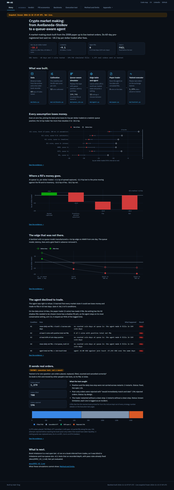

# Crypto market making: from Avellaneda–Stoikov to a queue-aware agent

**Live page: [xuantung9999-create.github.io/Market-Making-ASv2](https://xuantung9999-create.github.io/Market-Making-ASv2/)** · [Code layout](#layout) · 2-minute read · Author: Nguyễn Xuân Tùng, [CV](dashboard/cv/NguyenXuanTung_CV.pdf) · [LinkedIn](https://www.linkedin.com/in/tungtea-nguyen)

**The result is negative, and that is the finding.** A candidate edge on tick-constrained micro caps (+16 bp per dollar traded on one day) was put through a pre-registered test: 60 days, three coins, a queue model, 300 ms latency and base-tier fees. It did not survive.

| 13 Sep - 11 Nov 2026, COTI / ANKR / SKL, always quoting the best price | Before fees | After 10 bp maker fee | t (per coin-day) |
| --- | ---: | ---: | ---: |
| Queue = 1.0x displayed size (headline) | -8.2 bp | -18.2 bp | -8.4 |
| Queue = 0.5x (optimistic) | -7.0 bp | -17.0 bp | -8.6 |
| Queue = 2.0x (stress) | -9.0 bp | -19.0 bp | -8.1 |
| Front of queue, 100 ms (the earlier assumption) | -1.3 bp | -11.3 bp | -8.5 |

Basis points per dollar traded, 180 coin-days (`results/queue_baseline.csv`). The t column treats each coin-day as one observation; pooling the three coins by date (60 dates) gives t = -9.1 at the headline queue, the figure on the page's Verdict tab. The self-calibrating agent, which learns the net edge of a fill per market state from shadow orders, concluded that every state it could see loses money and declined to trade on all 159 coin-days (53 test days per coin after its warm-up) (**Gate A: fail**, `results/gate_a.json`).



More screenshots: [Verdict](docs/img/showcase-verdict-1440.png) · [Fill economics](docs/img/showcase-fills-1440.png) · [Agent](docs/img/showcase-agent-1440.png) · [Execution test](docs/img/showcase-exec-test-1440.png) · [Story on a phone](docs/img/showcase-story-390.png). Every public page at 1,440 and 390 px is in `docs/img/showcase-<page>-<width>.png`.

## What was built

A market-making stack on Binance spot, from the Avellaneda & Stoikov (2008) paper to live testnet orders, in six stages:

1. **Data** (`mm/data.py`, `mm/recorder.py`): Binance trades from the public archive, checksum-verified, and a live order-book recorder.
2. **Calibration** (`mm/calibrate.py`): volatility, tick and the fill-rate curve per coin, for 12 coins from BTC to micro caps.
3. **Queue-aware simulator** (`mm/queue_sim.py`): replays the tape with queue position, latency and fees, with an exact P&L identity.
4. **Edge table and agent** (`mm/edge.py`, `mm/agent.py`): learns what a fill is worth per market state from shadow orders and picks one of 12 settings, or stays out.
5. **Paper trader** (`mm/paper.py`): runs the agent on live mainnet data with simulated fills.
6. **Testnet executor** (`mm/testnet.py`): the same agent sending real post-only orders to the Binance spot testnet, to prove the execution code (an execution test, not a result).

Over 500 tests. The page (`dashboard/`, no build step) is one case study read top to bottom; Python writes every number and sentence on it (`scripts/build_story.py`, `mm/report.py`).

> **What I did myself**
>
> - **Framed the question:** does the one-day +16 bp micro-cap edge survive a queue model, latency and fees?
> - **Set the pass/fail rules first:** Gate A's five conditions, the 7-day warm-up and "if it fails, stop, don't tune", all fixed before the 60-day run (`docs/BUILD_GUIDE.md`, Task 8).
> - **Wrote the specs and working rules** every build followed: a spec per task, tests first, one task per session (`docs/BUILD_GUIDE.md` section 3, the `docs/*_SPEC.md` files).
> - **Reviewed every task** against its spec (rulings in `docs/progress/v2_ledger.md`).
> - **Called the result:** stopped at the negative finding, published it, and fixed the v2.1 rules before any of its data exists (`docs/SPEC_V2_1.md`).

## How it was built

The design, test rules and pass/fail gates are written as specs (`docs/`), and most of the code was implemented by AI models working to those specs, one task at a time, with tests first. Findings by day: `notes/`. Build log: [`docs/progress/v2_ledger.md`](docs/progress/v2_ledger.md).

## What is next

v2 ran on a book inferred from trades, so it never saw real book imbalance or queue sizes; v2.1 ([`docs/SPEC_V2_1.md`](docs/SPEC_V2_1.md)) tests that one remaining lever on recorded order-book data, with every pass rule fixed in advance. The code is built and tested; none of the pass rules has been evaluated yet, because each needs several weeks of recorded book data per coin.

## Run it

With Docker (no Python needed):

```bash
docker compose up dashboard        # http://localhost:8000/dashboard/index.html
docker compose run --rm tests      # run the test suite
```

Full instructions, including the live order-book recorder: [DOCKER.md](DOCKER.md).

With Python 3.11+:

```bash
git clone https://github.com/xuantung9999-create/Market-Making-ASv2.git && cd Market-Making-ASv2
python -m venv .venv
source .venv/bin/activate          # Windows: .venv\Scripts\activate
pip install -r requirements.txt
pytest -q                          # all tests should pass
python -m scripts.publish_dashboard   # the public copy in dashboard_public/ (add --live-snapshot for the testnet sessions)
```

On Windows the launchers are in `scripts/windows/`; `run_24x7.bat` (recorder, traders and live page, kept running) and `run_dashboard.bat` stay at the root.

## Testnet trading (real orders, fake money)

`mm/testnet.py` runs the same self-calibrating agent as the paper trader, but sends its quotes as
real `LIMIT_MAKER` (post-only) orders to the Binance **spot testnet**. It checks that orders are
placed, replaced, filled, counted and cancelled correctly before any real money is involved.

1. Get keys: https://testnet.binance.vision → log in with GitHub → *Generate HMAC_SHA256 Key*.
2. Copy `.env.example` to `.env` and paste the key and secret (`.env` is git-ignored).
3. Run it: double-click `scripts/windows/run_testnet.bat`, or

```bash
python -m mm.testnet --symbols BTCUSDT --dry-run --hours 0.1   # testnet data, orders only logged
python -m mm.testnet --symbols BTCUSDT --policy join            # always quote best bid/ask: plumbing test
python -m mm.testnet --symbols BTCUSDT                          # the agent (quotes only when it sees edge)
docker compose --profile live up testnet                        # same as --policy join, in Docker
```

Guards work on the **real** position: inventory cap (`--q-max` lots of `--lot-usd`), spot balance,
daily loss stop (`--max-loss`), and every open order is cancelled on exit. The agent's simulated
live track is given the real inventory before each decision. Logs: `data/testnet/<SYMBOL>/`
(`orders_*.jsonl`, `fills_*.jsonl`, `status.json`).

**Do not read testnet P&L as a result.** The testnet book is thin and moved by other people's
test bots, so fills and adverse selection look nothing like the real market. Judge the model with
the paper trader (`mm/paper.py`: real data, simulated fills); use testnet to prove the execution
code. Only a few coins exist on testnet (BTC, ETH, BNB and some others), not the micro caps.

## Layout

```
mm/strategy.py        A-S core: reservation price, spread, quote()
mm/simulator.py       Brownian mid + Poisson fills, inventory vs symmetric (paper s.4)
mm/data.py            Binance aggTrades downloader (checksum-verified), trades -> time bars
mm/recorder.py        live websocket recorder: bookTicker + aggTrade -> parquet
mm/backtest.py        event-driven backtest: bars, latency, conservative fills, fees, P&L attribution
mm/calibrate.py       per-coin tick, spread, sigma, A, k, two-part (core/tail) fill curve, gamma from target skew
mm/flow.py            past-only flow features (imbalance, momentum, vol ratio, sweeps) and the alpha model
mm/protect.py         A-S or GLFT with defences: lean on predicted flow, kill switch; matches mm.strategy.quote
mm/metrics.py         P&L per volume, markouts, adverse selection, Sharpe, drawdown
mm/tape.py            book tapes (inferred from trades, or recorded) and the merged event stream
mm/features.py        incremental, past-only features: book imbalance, microprice, flow, volatility ratio
mm/queue_sim.py       v2 engine: queue position, latency, fills, exact P&L identity
mm/edge.py            net edge per fill, EdgeTable (shrunk, forgetting), EdgePolicy
mm/agent.py           calibration agent: shadow orders, 12-setting menu, loss stop
mm/screen.py          which coins are tick-constrained
mm/paper.py           paper trader: live mainnet data, simulated fills, no orders sent
mm/testnet.py         testnet trader: the same agent, real post-only orders on the Binance spot testnet
mm/report.py          run bundles behind the page; scripts/build_story.py writes the Story
scripts/windows/      Windows launchers (.bat), each run from the repo root
notes/derivation.md   Day 1 derivation of the model
dashboard/index.html  the page (guide: docs/DASHBOARD_GUIDE.md); public copy by scripts/publish_dashboard.py
```

## Model

Reservation price `r = s − q·γ·σ²·(T − t)`; total spread `γσ²(T − t) + (2/γ)·ln(1 + γ/k)`; quotes `r ± spread/2`. Full derivation in [`notes/derivation.md`](notes/derivation.md).

How the project got here, day by day: [`notes/HISTORY.md`](notes/HISTORY.md).
