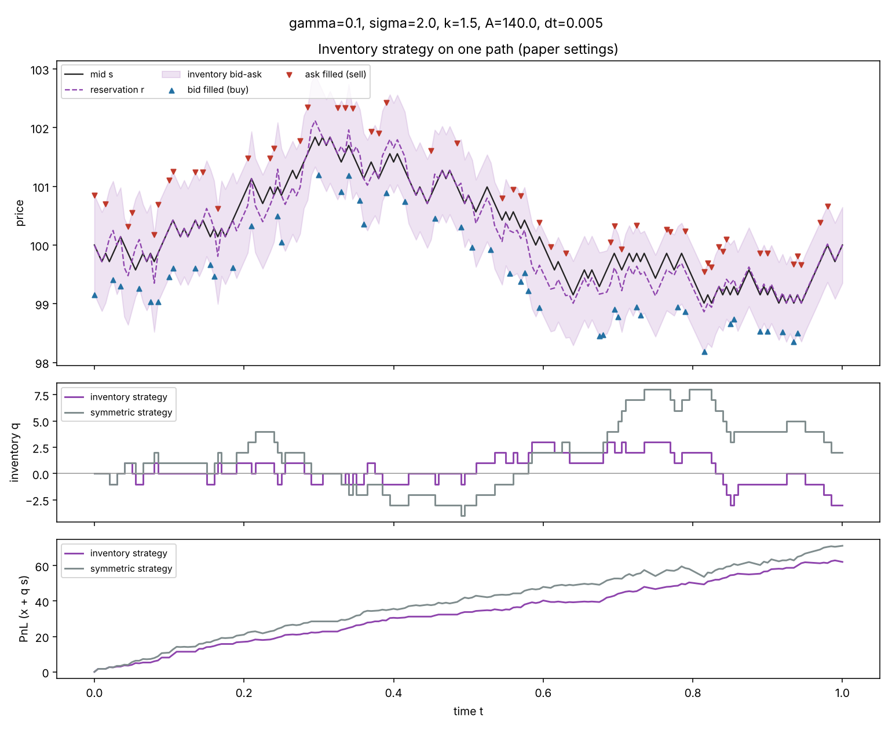
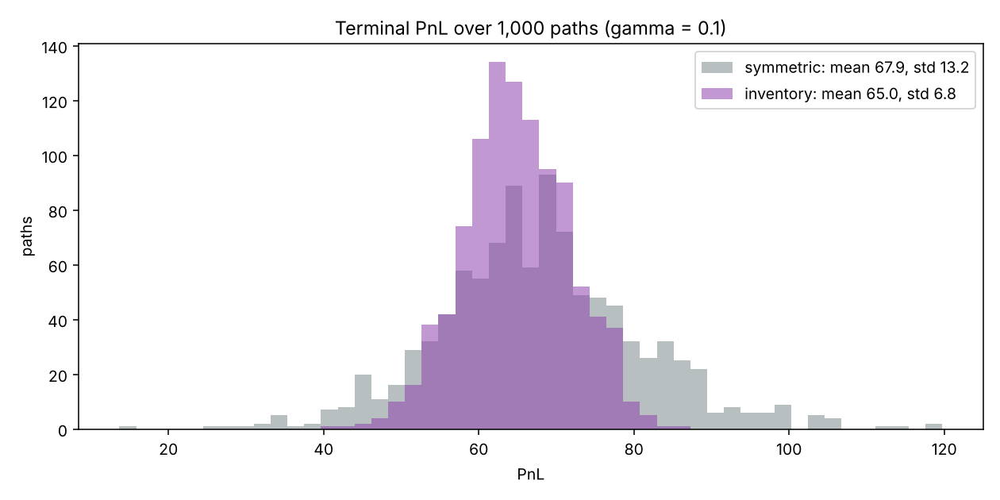
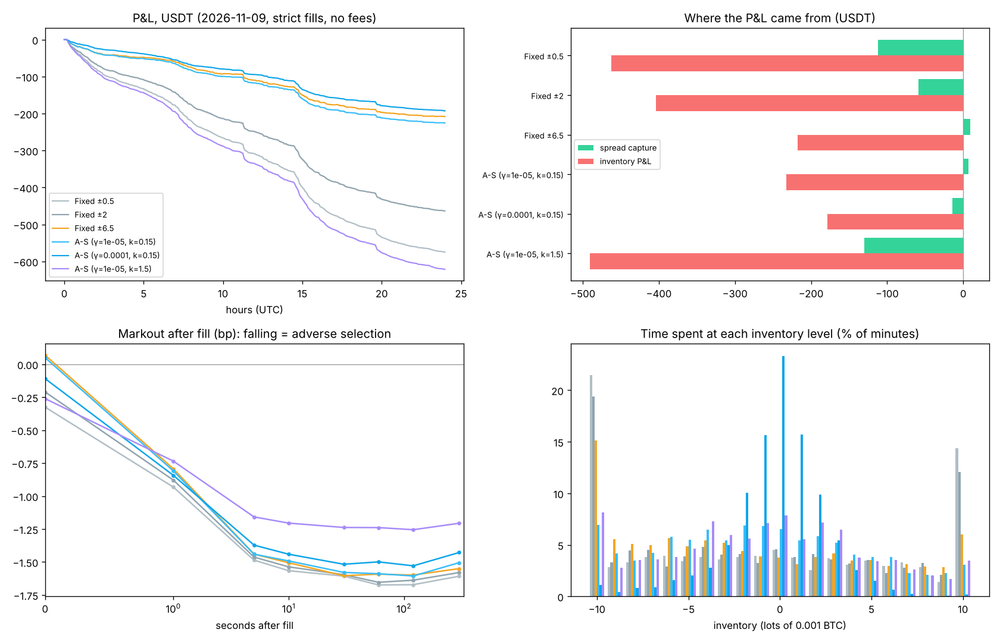
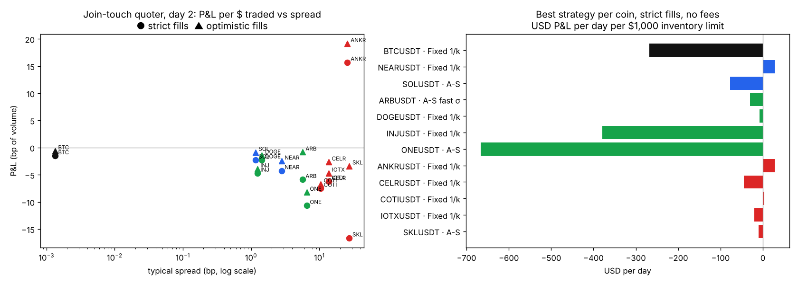
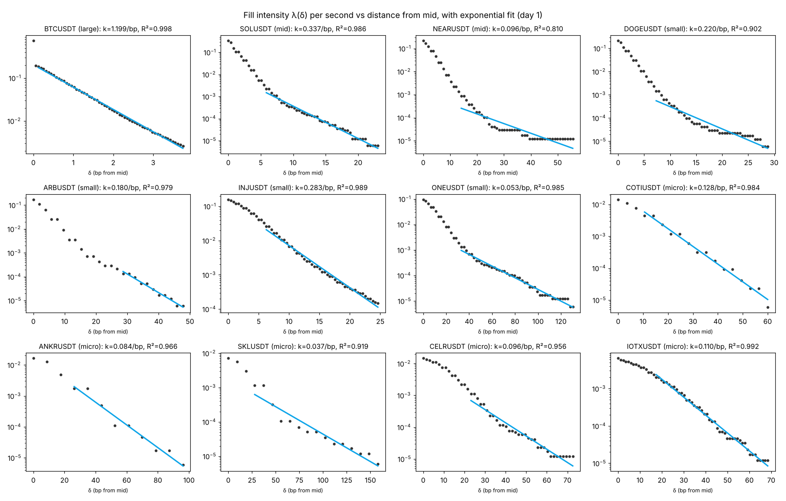
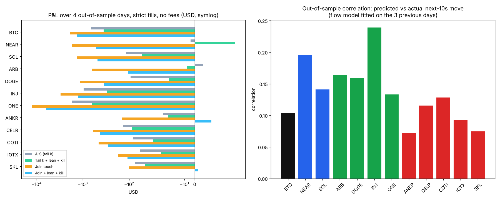
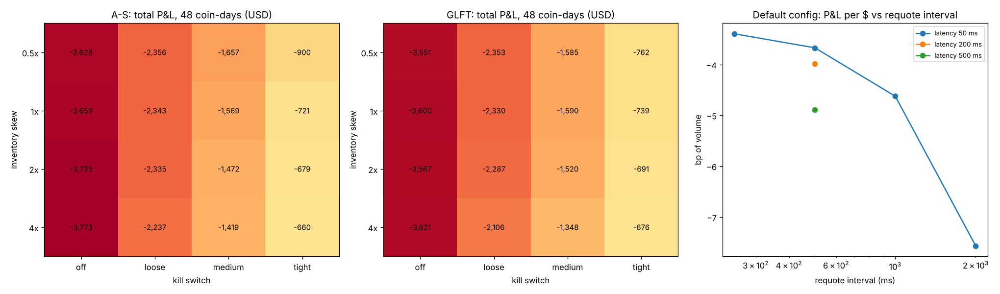
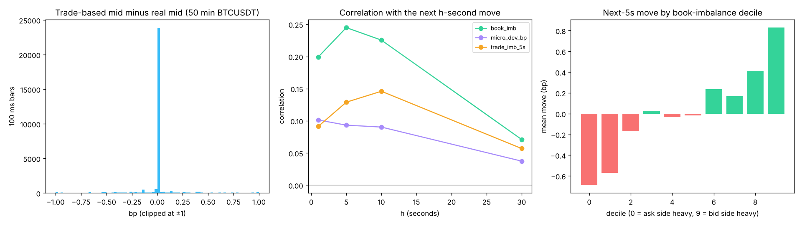

# How the project got here, day by day

The v1 work (Days 1-10, 11-12 Nov 2026) that led to the 60-day queue-aware test in the [README](../README.md). Each
section is a result as it stood on that day; later work changed some of them, and the Day 8 section says so. The
build plan is in [`docs/PROJECT_PLAN.md`](../docs/PROJECT_PLAN.md), the v2 build log in
[`docs/progress/v2_ledger.md`](../docs/progress/v2_ledger.md).

## Paper replication (Days 3-4: synthetic market, 1,000 paths, same random numbers for both strategies)

| γ | Strategy | Avg spread | Mean PnL | Std PnL | Std final q |
|---|---|---:|---:|---:|---:|
| 0.01 | inventory | 1.35 | 68.4 | 9.1 | 5.3 |
| 0.01 | symmetric | 1.35 | 68.6 | 13.6 | 8.5 |
| 0.1 | inventory | 1.49 | 65.0 | 6.8 | 3.0 |
| 0.1 | symmetric | 1.49 | 67.9 | 13.2 | 8.3 |
| 0.5 | inventory | 2.16 | 48.6 | 5.9 | 2.0 |
| 0.5 | symmetric | 2.16 | 58.2 | 11.4 | 6.9 |

The inventory strategy gives up a little mean profit for roughly half the PnL volatility and far tighter inventory; higher γ pushes further along that trade-off. This is the pattern reported in section 4 of the paper.




## First real-data result (Day 7)

On 9–10 Nov 2026 BTCUSDT (1.85M trades), with strict fills, 50 ms latency and no fees, **every strategy lost money**: about −1.5 bp per dollar traded, for fixed spreads and A-S alike. Fills are worth ~0 at the moment of the fill and −1.2 to −1.7 bp ten seconds later: quotes behind the best price are only reached by sweeps that keep going (adverse selection). A-S with γ = 1e-4 still did its job, cutting inventory std from ~7 lots to under 3. Details: [`week1_review.md`](week1_review.md).



## From BTC to micro caps (Day 8)

> Superseded. This micro-cap result came from one day and a simulator with no queue model. The 60-day queue-aware test that
> followed (13 Sep – 11 Nov 2026, COTI, ANKR and SKL, 300 ms latency, 10 bp maker fee; results in the [README](../README.md))
> reverses it: always quoting the best price lost 18.2 bp per dollar traded after fees at the headline queue assumption.

Twelve coins, tiers from measured Binance spot volume ($1.2B/day BTC down to $0.1M/day IOTX), calibrated on 9 Nov and backtested out of sample on 10 Nov. The tick size relative to price is the biggest difference: 0.001 bp for BTC, 26–27 bp for ANKR and SKL, which are tick-constrained. Large and mid caps lose to adverse selection like BTC; the only statistically meaningful positive result is on tick-constrained micro caps (ANKR: +16 bp per dollar traded, 60-s markout t = 2.2), where queue position decides the outcome. One day and a few hundred fills: promising, not proven. Advice on what changes for small caps: [`day8_small_caps.md`](day8_small_caps.md).




## Informed traders (Day 9, walk-forward)

12 coins × 4 out-of-sample days, everything calibrated on the 3 previous days. Trade imbalance predicts the next 10 seconds on every coin (out-of-sample correlation 0.07–0.24, direction right 58–65% of the time). A kill switch (no quotes during volatility bursts or just after sweeps) plus leaning quotes on the prediction cut losses by 60% and beat the Day-8 calibration on 11 of 12 coins, but mostly by trading less in the worst moments: per-dollar losses improve only 15%, and everything is negative after a 2 bp fee. A better-fitting fill curve made results worse, because A-S counts fills but cannot tell good ones from toxic ones. Details: [`day9_informed_flow.md`](day9_informed_flow.md).



## Tuning and signals (Days 9–10)

A 32-setting sweep over 48 out-of-sample coin-days: the kill switch dominates (losses −3,659 → −660 USD from off to tight), A-S and the infinite-horizon GLFT model end up close, and choosing settings from past days only cuts losses 58% out of sample. Slow quotes get picked off: requoting every 2 s instead of 250 ms more than doubles the loss per dollar traded, and latency matters (measured ~285 ms from a home PC in Vietnam). The BTC perpetual future leads BTC spot (prediction correlation 0.10 → 0.18) and BTC leads altcoins, but better prediction barely moved P&L. Fifty minutes of live order book show the trade-based mid is unbiased but noisy, and that book imbalance predicts the next 5 s twice as well as trade flow. Details: [`day10_tuning_signals.md`](day10_tuning_signals.md).




## The day-by-day commands

Run from the repo root with the virtual environment active (see the README, "Run it").

```bash
python -m scripts.plot_quotes      # day 2: writes results/day2_quotes.png
python -m scripts.replicate_paper  # day 3-4 figures + results/day4_paper_table.csv
python -m scripts.day4_experiments # study-guide experiments

# Real data (day 5): Binance public archive, no API key
python -m mm.data download --symbol BTCUSDT --date 2026-11-10 --days 2
python -m scripts.explore_day data/BTCUSDT_2026-11-10_trades.parquet
python -m scripts.run_backtest     # day 7: A-S vs fixed spreads on real data (~1 min/day)
python -m scripts.download_universe  # day 8: 9-10 Nov for a range of coins, BTC to micro caps
python -m scripts.run_universe     # day 8: calibrate day 1, backtest day 2 for every coin (~4 min)
python -m scripts.download_universe --date 2026-11-04 --days 5   # day 9: more history
python -m scripts.run_walkforward  # day 9: calibrate on 3 days, test the next; flow model + kill switch (~10 min)
python -m scripts.run_sweep        # day 9: A-S vs GLFT x skew x kill switch, tuned on past days (~20 min)
python -m mm.data download --symbol BTCUSDT --date 2026-11-04 --days 7 --market futures --out data/futures
python -m scripts.run_leadlag      # day 10: BTC spot / perp flow as leading signals (~2 min)
python -m scripts.book_study       # day 10: live order book from the recorder
python -m mm.recorder --symbol BTCUSDT          # live best bid/ask + trades, Ctrl+C to stop
```
